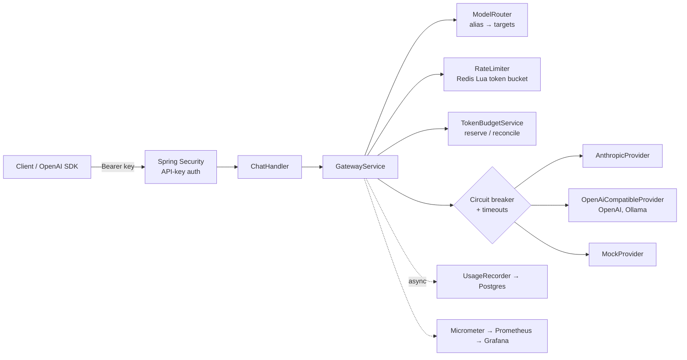

# LLM Gateway


A self-hosted gateway that sits between your applications and LLM providers (OpenAI, Anthropic, local Ollama models).
Apps call **one OpenAI-compatible endpoint**. The gateway handles routing, failover, rate limits, token budgets
and cost tracking, so individual teams don't have to.

Built with **Java 21, Spring Boot 3 (WebFlux), Spring Security, Redis, PostgreSQL (R2DBC), Resilience4j and Micrometer**.

```
Your app ──► LLM Gateway ──► Anthropic
 (any OpenAI SDK)   │    └──► OpenAI
                    │    └──► Ollama (local)
                    ├─ auth, rate limits, budgets   (Redis)
                    ├─ failover + circuit breakers  (Resilience4j)
                    └─ usage, cost, metrics         (Postgres, Prometheus, Grafana)
```

## Features

- **OpenAI-compatible API**: `POST /v1/chat/completions` (JSON and streaming SSE) and `GET /v1/models`.
  Existing apps switch over by changing the base URL.
- **Model aliases with failover**: request `fast` and the gateway tries Anthropic, then OpenAI, then a local model.
  Routes are configuration, not code.
- **Per-provider circuit breakers**: when a vendor has an outage, requests skip it immediately instead of waiting for timeouts.
- **Streaming done right**: timeouts for the first token and for gaps between tokens, failover before the first
  token, and correct usage accounting even when the client disconnects mid-stream.
- **Multi-tenant API keys**: keys are stored as SHA-256 hashes and shown only once.
- **Distributed rate limiting**: a token bucket implemented as an atomic Redis Lua script, correct across many gateway instances.
- **Daily token budgets** using reserve-then-reconcile, so concurrent requests can't overspend together.
- **Cost tracking**: every request is priced and recorded in Postgres, with an admin API for usage reports.
- **Observability**: Prometheus metrics, a provisioned Grafana dashboard, and circuit-breaker state.
- **Mock providers**, so the whole system can be demoed, tested and load-tested without any API keys.

## Architecture



What happens to each request:

1. **Authenticate**: hash the key, look it up (cached for 60s), and resolve the tenant.
2. **Route**: turn the alias into an ordered list of `(provider, model)` targets, skipping providers with no credentials.
3. **Admit**: take one token from the tenant's rate-limit bucket, then reserve the estimated tokens from the daily budget.
4. **Call**: try each target in turn, behind its circuit breaker and timeouts. Retryable errors move on to the next target.
5. **Settle**: correct the budget reservation to the actual usage, price the call, and record the usage event and metrics.
   The client never waits for this step.

## Quick start (no API keys needed)

Prerequisites: Java 21, Maven, Docker.

```bash
docker compose up -d            # Postgres, Redis, Prometheus, Grafana
mvn spring-boot:run             # gateway on http://localhost:8080
```

A dev tenant is created at startup with the key `sk-dev-local`.

```bash
# Non-streaming
curl -s localhost:8080/v1/chat/completions \
  -H 'Authorization: Bearer sk-dev-local' -H 'Content-Type: application/json' \
  -d '{"model":"mock","messages":[{"role":"user","content":"Hello!"}]}' | jq

# Streaming (watch tokens arrive)
curl -N localhost:8080/v1/chat/completions \
  -H 'Authorization: Bearer sk-dev-local' -H 'Content-Type: application/json' \
  -d '{"model":"mock","stream":true,"messages":[{"role":"user","content":"Hello!"}]}'

# Chaos route: the first provider fails 50% of the time. Check the X-Gateway-Fallbacks header.
curl -si localhost:8080/v1/chat/completions \
  -H 'Authorization: Bearer sk-dev-local' -H 'Content-Type: application/json' \
  -d '{"model":"chaos","messages":[{"role":"user","content":"Hi"}]}' | grep -i x-gateway
```

From any OpenAI SDK, for example Python:

```python
from openai import OpenAI
client = OpenAI(base_url="http://localhost:8080/v1", api_key="sk-dev-local")
print(client.chat.completions.create(model="mock", messages=[{"role": "user", "content": "Hi"}]).choices[0].message.content)
```

Grafana is at http://localhost:3000 (dashboard: **LLM Gateway**), and Prometheus is at http://localhost:9090.

### Using real providers

Copy `.env.example` to `.env` and add `OPENAI_API_KEY` and/or `ANTHROPIC_API_KEY`, then restart.
The `fast` and `smart` aliases start working, and they fail over between whichever providers are configured.
For free local models, run `docker compose --profile local-llm up -d` and `docker exec -it <ollama-container> ollama pull llama3.2`,
then use `"model": "local"`.

> Model names and prices in `application.yml` are examples. Check them against each provider's model list and pricing page.

## Configuration

Everything lives under `gateway.*` in [`application.yml`](src/main/resources/application.yml).

```yaml
gateway:
  providers:
    anthropic: { type: anthropic, base-url: https://api.anthropic.com, api-key: ${ANTHROPIC_API_KEY:} }
    ollama:    { type: openai,    base-url: http://localhost:11434/v1 }
  routes:
    fast:                                   # tried in order
      - { provider: anthropic, model: claude-haiku-5-5 }
      - { provider: ollama,    model: llama3.2 }
  pricing:
    claude-haiku-5-5: { input-per-million: 1.00, output-per-million: 5.00 }
```

Clients can also skip aliases and call `"<provider>/<model>"`, for example `"openai/gpt-5"`.

## API

| Endpoint | Auth | Purpose |
|---|---|---|
| `POST /v1/chat/completions` | tenant key | OpenAI-compatible chat (set `"stream": true` for SSE) |
| `GET /v1/models` | tenant key | List model aliases |
| `POST /admin/tenants` | admin key | Create tenant, returns its first API key (shown once) |
| `GET /admin/tenants` | admin key | List tenants and active key counts |
| `POST /admin/tenants/{id}/keys` | admin key | Issue another key |
| `DELETE /admin/keys/{id}` | admin key | Revoke a key |
| `GET /admin/usage/summary?hours=24` | admin key | Requests, tokens, cost, latency and errors per tenant and provider |
| `GET /admin/providers` | admin key | Provider config and circuit-breaker state |

```bash
curl -s -X POST localhost:8080/admin/tenants \
  -H 'Authorization: Bearer admin-dev-key' -H 'Content-Type: application/json' \
  -d '{"name":"search-team","requests_per_minute":600,"daily_token_budget":2000000}'
```

Errors use OpenAI's envelope (`{"error": {"message", "type", "code"}}`), so SDKs surface them normally.
Responses carry `X-Request-Id`, `X-Gateway-Provider` and `X-Gateway-Fallbacks` headers. Rate-limit responses also carry `Retry-After`.

## Design decisions and trade-offs

| Decision | Why | Trade-off |
|---|---|---|
| **WebFlux end to end** | A gateway spends nearly all its time waiting on slow upstream streams; non-blocking I/O handles thousands of concurrent streams on a few threads. | Reactive code is harder to read and debug than virtual threads + MVC (a good alternative on Java 21). |
| **Fail over only before the first streamed token** | After bytes reach the client, switching providers would splice two different answers together. | A provider that dies mid-stream surfaces an error event instead of recovering. |
| **Separate first-token and idle timeouts** | A single "total" timeout either kills long legitimate generations or waits too long on a dead provider. | Two values to tune per deployment. |
| **Circuit breaker per provider; only 5xx/401/403/timeouts count** | A 400 means the request is bad, not the provider. Counting it would let one buggy client trip the breaker for everyone. | Slow-call detection is effectively off, since long streams are normal. |
| **Token bucket in a Redis Lua script, using Redis `TIME`** | Atomic read-modify-write across instances, with no clock skew between gateway nodes. | Redis is on the request path (one round trip). |
| **Fail open when Redis is down** | For an internal platform, availability beats strict enforcement. Each fail-open increments `gateway_fail_open_total`. | Limits aren't enforced during a Redis outage. Flip this for a paid public API. |
| **Budget reserve-then-reconcile** | Real token counts are only known after the response. Reserving up front stops N concurrent requests from all passing the same check. | Budgets can briefly over-reserve; a request larger than the remaining budget is rejected even if it would have used fewer tokens. |
| **Usage written asynchronously** | The client never waits on the database. | An event can be lost on a crash. The fix is Kafka or an outbox (see roadmap). |
| **Hashed API keys plus a 60s cache** | A database leak doesn't leak keys, and the hot path avoids Postgres. | A revoked key works on other instances for up to 60s. |
| **Usage estimated when the provider doesn't report it** | Disconnected streams and some local models don't report usage, and they still need accounting. | Estimates (~4 chars/token) are flagged with `tokens_estimated` so reports can tell them apart. |

## Observability

Metrics at `/actuator/prometheus`:

- `gateway_requests_total{model,provider,status}`
- `gateway_tokens_total{tenant,provider,type}`
- `gateway_cost_usd_total{tenant,provider}`
- `gateway_ttft_seconds` (histogram)
- `gateway_upstream_latency_seconds` (histogram)
- `gateway_fallbacks_total{from_provider,reason}`
- `gateway_rejections_total{reason}`
- `gateway_fail_open_total{component}`
- `resilience4j_circuitbreaker_*`

Every request also logs one structured summary line with its tenant, provider, tokens, cost, latency and fallbacks.

## Testing

```bash
mvn verify
```

- **Unit tests**: routing rules and the Anthropic ⇄ OpenAI translation, including stream events.
- **Integration tests**: real Postgres and Redis via Testcontainers, and two WireMock upstreams. They cover failover over
  real HTTP, failover before the first streamed token, rate limiting with `Retry-After`, budget rejection,
  the 401/403 paths, and that usage rows are written.

## Load testing

`loadtest/chat.js` ([k6](https://k6.io)) uses the zero-latency `mock-fast` route to measure the gateway's own overhead.
See the comments at the top of the script for setup. Record your p50/p95 and requests/second here.

| Scenario | Rate | p95 latency | Errors |
|---|---|---|---|
| mock-fast, non-streaming | _fill in_ | _fill in_ | _fill in_ |

## Roadmap

- [ ] **Semantic cache**: embed prompts into pgvector and return cached answers above a similarity threshold (temperature-0 requests only, scoped per tenant).
- [ ] **PII redaction** before prompts leave the network.
- [ ] **Angular admin dashboard** on top of `/admin/*`: tenants, keys, usage and cost charts, provider health.
- [ ] Tool or function calling and multimodal pass-through.
- [ ] Usage events through Kafka or a transactional outbox for at-least-once delivery.
- [ ] Upgrade to Spring Boot 4.

## Project layout

```
src/main/java/dev/llmgateway
├── api/            HTTP layer: OpenAI-compatible routes, handler, DTOs
├── core/           GatewayService pipeline, errors, metrics, token estimation
├── routing/        Model aliases → provider targets
├── provider/       LlmProvider + adapters (openai, anthropic, mock)
├── ratelimit/      Redis token bucket + daily budgets (Lua scripts in resources/scripts)
├── auth/           API keys, tenants, Spring Security integration
├── usage/          Cost calculation, usage recording and reports
├── admin/          Admin REST API
└── config/         Typed configuration, security, provider wiring
```

## Troubleshooting

- **Testcontainers can't reach Docker** (common with very new Docker Engine versions): bump the Testcontainers
  version in `pom.xml` (`<testcontainers.version>`) to the latest release.
- **`fast`/`smart` return 503 "No configured provider"**: no API key is set for any provider in that route.
  Use `mock`/`chaos`, add keys to `.env`, or run Ollama for `local`.
